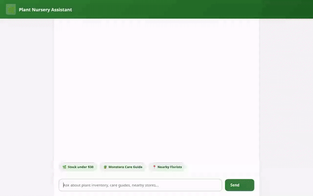

# 🌿 Plant Nursery Assistant

An intelligent AI assistant for plant nurseries built with the **Agent Development Kit (ADK)**, **Gemini 2.5 Flash**, **A2UI rich UI rendering**, and **Google Cloud Platform services**.



---

## 🚀 Capabilities & Features

The agent provides interactive customer assistance, inventory management, weather-based plant care advice, geocoding, local store discovery, image generation, and video generation:

* **🌿 Plant Inventory Management (Firestore)**:
  * `search_plants`: Search store inventory with optional category and max price filters.
  * `add_plant`: Insert or update plant document records in Google Cloud Firestore.
  * `get_care_guide`: Retrieve care guides (sunlight, watering frequency, pet toxicity).
* **☀️ Outdoor Weather & Gardening Advice**:
  * `get_local_weather_and_gardening_advice`: Fetch current temperature and weather conditions via Open-Meteo REST API to generate outdoor watering and care recommendations.
* **📍 Geocoding & Local Nursery Search (Google Maps & Places API)**:
  * `geocode_address`: Geocode street addresses or cities into latitude/longitude coordinates.
  * `search_nearby_places`: Locate nearby florists, nurseries, or parks using the Google Places API (New).
* **🎨 AI Visual Asset Generation & Cloud Storage (Vertex AI & GCS)**:
  * `generate_plant_image`: Generates custom plant images using `gemini-3.1-flash-lite-image` in the `global` region, saves them as ADK session artifacts, and uploads the image to a public Google Cloud Storage bucket.
  * `generate_plant_video`: Generates short plant video clips using `gemini-omni-flash-preview` in the `global` region, saves them as session artifacts, and uploads the video to Google Cloud Storage.
* **🧠 Agent Memory Bank (Vertex AI Agent Engine)**:
  * Integrated with `VertexAiMemoryBankService` to store and remember long-term user preferences (such as user plant allergies).
* **🎨 Rich Agent-to-User Interface (A2UI)**:
  * Uses `A2uiSchemaManager` (version 0.8) and `BasicCatalog` callback (`after_model_callback`) to render rich UI cards (Cards, Columns, Rows, Text, Images) dynamically in chat.

---

## 🛠️ Tech Stack & Google Cloud Architecture

* **Framework**: Agent Development Kit (ADK) in Python
* **LLM**: Gemini 2.5 Flash (`gemini-2.5-flash` on Vertex AI)
* **Image Model**: `gemini-3.1-flash-lite-image` (Global region)
* **Omni Video Model**: `gemini-omni-flash-preview` (Global region)
* **Database**: Google Cloud Firestore
* **Asset Storage**: Google Cloud Storage (GCS)
* **Long-term Memory**: Vertex AI Agent Engine Memory Bank
* **Geospatial**: Google Maps Geocoding API & Google Places API (New)
* **UI Protocol**: A2UI (v0.8 Basic Catalog) with FastAPI proxy frontend

---

## ⚙️ Local Development Setup

### 1. Prerequisites
Ensure Python 3.10+, `uv`, `gcloud` CLI, and environment variables are configured:

```bash
export GOOGLE_CLOUD_PROJECT="your-gcp-project-id"
export GOOGLE_CLOUD_LOCATION="us-east4"
export GOOGLE_MAPS_API_KEY="your-google-maps-api-key"
```

### 2. Install Dependencies
Install Python dependencies using `uv`:

```bash
uv sync
```

### 3. Run Agent Playground
To run the agent locally in the ADK web playground with Memory Bank integration:

```bash
uv run adk web . --port 8080 --reload_agents --memory_service_uri=agentengine://<YOUR_AGENT_ENGINE_ID>
```

### 4. Run Custom Frontend Proxy Locally
To run the lightweight FastAPI proxy and web chat UI from `./frontend`:

```bash
cd frontend
uv sync
AGENT_ENGINE_RESOURCE_NAME="projects/<PROJECT_ID>/locations/us-east4/reasoningEngines/<ENGINE_ID>" \
AGENT_DIRECTORY="app" \
PORT=8080 \
uv run python main.py
```

---

## ☁️ Deployment Instructions

### Deploy Agent to Agent Runtime (Agent Engine)
Deploy the agent using `agents-cli`:

```bash
agents-cli deploy
```

### Deploy Frontend Proxy to Cloud Run
Deploy the frontend container to Cloud Run and grant the service account permissions:

```bash
cd frontend
gcloud run deploy demo-agent-frontend \
  --source . \
  --region us-east4 \
  --set-env-vars AGENT_ENGINE_RESOURCE_NAME="projects/<PROJECT_ID>/locations/us-east4/reasoningEngines/<ENGINE_ID>",AGENT_DIRECTORY="app" \
  --allow-unauthenticated
```
